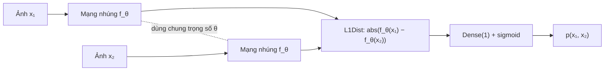
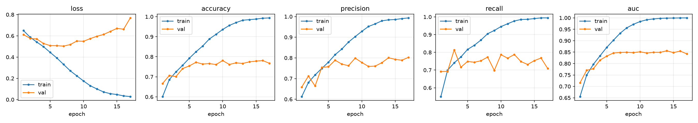
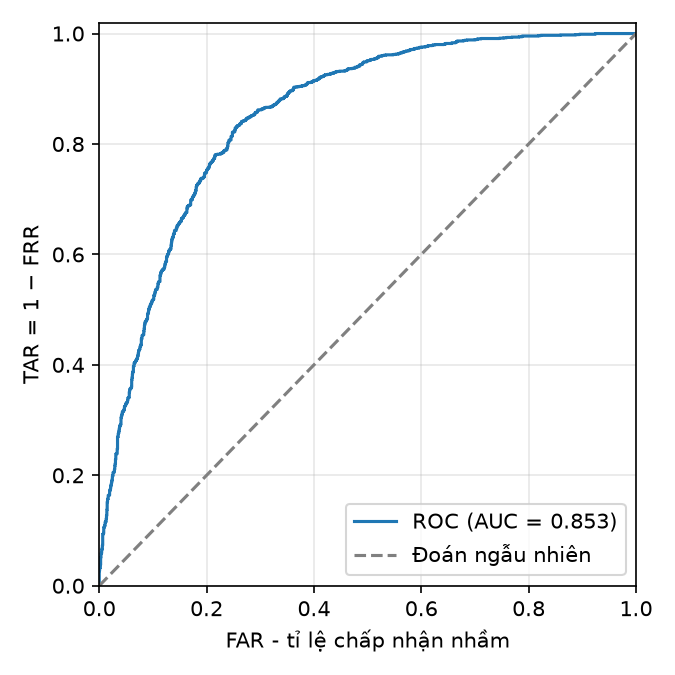
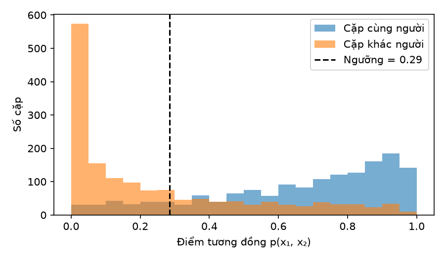

# Phương pháp: xác minh khuôn mặt one-shot bằng mạng Siamese

Tài liệu này trình bày cơ sở lý thuyết, mô hình, dữ liệu và giao thức thực nghiệm được
cài đặt trong gói `siamese_face`.

## 1. Bài toán

**Xác minh khuôn mặt** (*face verification*, so khớp 1:1) trả lời câu hỏi: *hai ảnh
$x_1, x_2$ có phải của cùng một người không?* Khác với **nhận dạng** (*identification*,
1:N) – tìm danh tính trong một tập người đã biết – bài toán xác minh có thể giải bằng một
hàm tương đồng $p(x_1, x_2) \in [0, 1]$ cùng một ngưỡng $\tau$:

$$
\text{cùng người} \iff p(x_1, x_2) \ge \tau .
$$

Trong thiết lập **one-shot**, hệ thống chỉ cần một (hoặc vài) ảnh tham chiếu của người dùng
thay vì hàng nghìn ảnh cho mỗi lớp như bài toán phân loại thông thường, vì mô hình học *cách
so sánh* hai ảnh chứ không học thuộc từng danh tính. Đây cũng là ý tưởng nền của các hệ
thống như DeepFace (Taigman và cộng sự, 2014) và FaceNet (Schroff và cộng sự, 2015).

## 2. Mạng Siamese

Mạng Siamese (Bromley và cộng sự, 1993; Koch và cộng sự, 2015) gồm hai nhánh **giống hệt
nhau và dùng chung trọng số** $\theta$. Mỗi nhánh là một mạng nhúng
$f_\theta : \mathbb{R}^{100 \times 100 \times 3} \to (0, 1)^{4096}$.

Vector khoảng cách và xác suất đầu ra:

$$
\mathbf{d} = \left| f_\theta(x_1) - f_\theta(x_2) \right| \in \mathbb{R}^{4096},
\qquad
p(x_1, x_2) = \sigma\left(\mathbf{w}^\top \mathbf{d} + b\right),
\qquad
\sigma(z) = \frac{1}{1 + e^{-z}} .
$$

Hai tính chất quan trọng:

- **Đối xứng**: $p(x_1, x_2) = p(x_2, x_1)$ vì hai nhánh dùng chung $f_\theta$ và
  $|a - b| = |b - a|$ (được kiểm thử trong `tests/test_model.py`).
- **Trọng số học được cho từng chiều**: khác với khoảng cách Euclid cố định, vector
  $\mathbf{w}$ cho phép mô hình tự học chiều đặc trưng nào quan trọng khi so sánh.

## 3. Kiến trúc mạng

Cài đặt trong `siamese_face/model.py`; in lại bằng `python -m siamese_face summary`.

| Lớp | Cấu hình | Kích thước đầu ra | Số tham số |
|---|---|---|---:|
| Input | ảnh RGB | 100×100×3 | 0 |
| Conv1 | 64 bộ lọc 10×10, ReLU | 91×91×64 | 19.264 |
| MaxPool1 | 2×2, bước 2, `same` | 46×46×64 | 0 |
| Conv2 | 128 bộ lọc 7×7, ReLU | 40×40×128 | 401.536 |
| MaxPool2 | 2×2, bước 2, `same` | 20×20×128 | 0 |
| Conv3 | 128 bộ lọc 4×4, ReLU | 17×17×128 | 262.272 |
| MaxPool3 | 2×2, bước 2, `same` | 9×9×128 | 0 |
| Conv4 | 256 bộ lọc 4×4, ReLU | 6×6×256 | 524.544 |
| Flatten | | 9.216 | 0 |
| Dense | 4096 nơ-ron, sigmoid | 4.096 | 37.752.832 |
| **Mạng nhúng $f_\theta$** | | | **38.960.448** |
| L1Dist | trị tuyệt đối hiệu hai vector | 4.096 | 0 |
| Dense (phân loại) | 1 nơ-ron, sigmoid | 1 | 4.097 |
| **Toàn mạng Siamese** | | | **38.964.545** |

Nhận xét:

- Khoảng **96,9%** tham số nằm ở lớp Dense 9.216 → 4.096. Đây là điểm nghẽn bộ nhớ
  (≈156 MB trọng số float32) và là ứng viên đầu tiên khi cần thu gọn mô hình (mục 10).
- Cạnh ảnh đầu vào tối thiểu là 58 pixel, để bốn lớp tích chập `valid` và ba lớp gộp còn
  kích thước dương.

## 4. Hàm mục tiêu và tối ưu

Với nhãn $y_i = 1$ (cùng người) hoặc $y_i = 0$ (khác người), mô hình được huấn luyện bằng
**binary cross-entropy**:

$$
\mathcal{L} = -\frac{1}{N} \sum_{i=1}^{N} \Big[ y_i \log p_i + (1 - y_i) \log (1 - p_i) \Big].
$$

| Siêu tham số | Mặc định | Tham số dòng lệnh |
|---|---|---|
| Thuật toán tối ưu | Adam (Kingma & Ba, 2015) | – |
| Tốc độ học | $10^{-4}$ | `--learning-rate` |
| Kích thước lô | 16 | `--batch-size` |
| Số epoch tối đa | 50 | `--epochs` |
| Dừng sớm | sau 10 epoch `val_loss` không giảm; luôn khôi phục trọng số tốt nhất | `--patience` |
| Tăng cường dữ liệu | tắt | `--augment` |
| Seed ngẫu nhiên | 42 | `--seed` |

## 5. Dữ liệu

Dự án hỗ trợ hai chế độ thực nghiệm (`--mode`):

| Chế độ | Cặp dương | Cặp âm | Mô hình thu được |
|---|---|---|---|
| `personal` | (anchor, positive) của một người | (anchor, ảnh LFW) | cá nhân hoá cho người đó |
| `lfw` | hai ảnh khác nhau của cùng một người trong LFW | hai ảnh LFW của hai người khác nhau | tổng quát, xác minh được cả người chưa từng thấy |

### 5.1. Chế độ `lfw` – tổng quát hoá cho người mới

LFW có 13.233 ảnh của 5.749 người, trong đó 1.680 người có từ hai ảnh trở lên. Quy trình:

1. **Chia theo danh tính:** mọi ảnh của một người nằm trọn trong train, val hoặc test (tỉ lệ
   70/15/15 tính theo số ảnh).
2. **Cặp dương:** mọi tổ hợp $\binom{k}{2}$ của người có $k \ge 2$ ảnh, giới hạn tối đa 20
   cặp mỗi người (`--max-pairs-per-identity`). Nếu không giới hạn, riêng George W. Bush
   (530 ảnh) đã có 140.185 cặp, áp đảo toàn bộ dữ liệu.
3. **Cặp âm:** rút ngẫu nhiên đều hai ảnh thuộc hai người khác nhau, với số lượng bằng số
   cặp dương.

Vì tập test chỉ gồm những người mô hình *chưa từng thấy*, số liệu đo được chính là khả năng
xác minh one-shot đúng nghĩa: chỉ cần một ảnh tham chiếu của người mới, không phải huấn luyện
lại. Đây là thiết lập gốc của Koch và cộng sự.

### 5.2. Chế độ `personal`

| Tập | Nội dung | Nguồn |
|---|---|---|
| Anchor ($A$) | ảnh của người cần xác minh | webcam (`collect`, phím `a`) |
| Positive ($P$) | ảnh khác của chính người đó | webcam (`collect`, phím `p`) |
| Negative ($N$) | ảnh của người khác | LFW: 13.233 ảnh của 5.749 người, mỗi ảnh 250×250 |

**Ghép cặp** (thực hiện riêng trong từng tập train/val/test): mỗi ảnh anchor $a_i$ tạo một
cặp dương $(a_i, p_i, 1)$ và một cặp âm $(a_i, n_i, 0)$. Dữ liệu vì vậy **cân bằng lớp**,
gồm $2n$ cặp với $n = \min(|A|, |P|, |N|)$.

Vì mọi cặp đều chứa một ảnh anchor của cùng một người, mô hình thu được là mô hình **cá
nhân hoá** cho người đó: thực chất là một bộ phân biệt "đúng người này hay không" được
học dưới dạng so sánh cặp. Muốn xác minh người khác thì phải thu ảnh và huấn luyện lại;
chế độ `lfw` không có hạn chế này.

### 5.3. Bộ nhớ đệm theo ảnh

Mỗi ảnh *duy nhất* chỉ được giải mã một lần và giữ trong RAM; mỗi cặp chỉ lưu hai chỉ số
trỏ tới ảnh (`pipeline.make_dataset`). Ở chế độ `lfw`, khoảng 20 nghìn cặp dùng chung
khoảng 13 nghìn ảnh, nên bộ nhớ cần ≈ 13.233 × 100 × 100 × 3 × 4 byte ≈ 1,6 GB. Nếu cache theo
từng cặp, con số này sẽ là vài GB.

## 6. Tiền xử lý và tăng cường dữ liệu

Một hàm duy nhất, `pipeline.load_image`, được dùng cho cả huấn luyện, đánh giá và suy luận
nhằm tránh lệch tiền xử lý giữa các giai đoạn (*training/serving skew*):

1. Giải mã ảnh JPEG/PNG/BMP, nhận dạng định dạng theo nội dung file chứ không theo đuôi.
2. Cắt vùng vuông lớn nhất ở giữa ảnh để không làm méo tỉ lệ khuôn mặt.
3. Resize song tuyến tính về 100×100.
4. Chuẩn hoá giá trị điểm ảnh về $[0, 1]$.

Ảnh tự thu bằng webcam được cắt sẵn vùng 250×250 ở giữa khung hình, cùng cỡ với ảnh LFW, để
hai nguồn dữ liệu có phân phối gần nhau.

**Tăng cường** (tuỳ chọn, chỉ áp dụng cho tập train, độc lập cho từng ảnh trong cặp): lật
ngang ngẫu nhiên, thay đổi độ sáng ±0,1, độ tương phản và độ bão hoà trong khoảng ×[0,8; 1,2].

## 7. Giao thức chia dữ liệu – chống rò rỉ

Cài đặt trong `data.build_splits`, theo ba nguyên tắc:

1. **Chia trước, ghép cặp sau.** Ảnh anchor, positive và negative được chia train/val/test
   (mặc định 70/15/15) *trước*, rồi mới ghép cặp bên trong từng tập. Nếu ghép cặp trước rồi
   mới chia, cùng một ảnh anchor có thể xuất hiện ở cả tập train lẫn tập test.
2. **Ảnh negative chia theo danh tính.** Tên file LFW có dạng `Ten_Nguoi_0001.jpg`; mọi ảnh
   của cùng một người nằm chung một tập, nên người lạ trong tập test là người mô hình *chưa
   từng thấy* khi huấn luyện.
3. **Chia tất định và lưu lại.** Seed được cố định và danh sách cặp lưu trong `splits.json`;
   lệnh `evaluate --run` dùng lại đúng tập test đó.

> **Lỗi rò rỉ thường gặp.** Nhiều bản cài đặt chia dữ liệu bằng `data.shuffle(10000)` rồi
> `take()`/`skip()`. Vì `tf.data` mặc định *xáo lại sau mỗi lượt duyệt*
> (`reshuffle_each_iteration=True`), tập "test" thay đổi ở mỗi epoch và lẫn với tập train,
> khiến số liệu đánh giá bị lạc quan. Dự án này chia một lần duy nhất trên danh sách file nên
> không mắc lỗi đó.

**Hạn chế còn lại:** các khung hình webcam chụp liên tiếp có thể gần như trùng nhau. Nên thu
ảnh anchor/positive qua nhiều phiên khác nhau (khác ngày, khác ánh sáng) để tập test đủ độc
lập.

## 8. Độ đo đánh giá

Quy ước: lớp dương là "cùng người"; mô hình dự đoán dương khi $p \ge \tau$.

| Độ đo | Công thức | Ý nghĩa |
|---|---|---|
| Accuracy | $(TP + TN) / (TP + TN + FP + FN)$ | tỉ lệ quyết định đúng |
| Precision | $TP / (TP + FP)$ | trong các lần chấp nhận, tỉ lệ đúng người |
| Recall (TAR) | $TP / (TP + FN)$ | tỉ lệ chủ thể được chấp nhận |
| F1 | $2PR / (P + R)$ | trung bình điều hoà của Precision và Recall |
| FAR | $FP / (FP + TN)$ | người lạ bị chấp nhận nhầm – **rủi ro an ninh** |
| FRR | $FN / (FN + TP) = 1 - \text{Recall}$ | chủ thể bị từ chối nhầm – **gây bất tiện** |
| ROC-AUC | diện tích dưới đường $(\mathrm{FAR}(\tau), \mathrm{TAR}(\tau))$ | chất lượng xếp hạng, không phụ thuộc ngưỡng |
| EER | giá trị tại ngưỡng $\tau$ mà $\mathrm{FAR} = \mathrm{FRR}$ | một con số tóm tắt sự đánh đổi FAR/FRR |

Tất cả các độ đo được cài đặt bằng NumPy trong `metrics.py`. Đường ROC được tính bằng cách
quét ngưỡng qua các điểm đã sắp xếp, với độ phức tạp $O(n \log n)$; AUC được tính bằng quy
tắc hình thang. Các hàm này được kiểm thử bằng những ví dụ có đáp án biết trước.

## 9. Chọn ngưỡng và quy tắc suy luận

**Chọn ngưỡng** (`evaluate.py`): ngưỡng $\tau$ được chọn trên **tập val** theo một trong
ba tiêu chí, rồi giữ cố định khi đo trên **tập test**. Nhờ vậy, ngưỡng không được chọn bằng
chính dữ liệu dùng để báo cáo kết quả.

- `f1`: chọn ngưỡng cho F1 lớn nhất (mặc định);
- `youden`: chọn ngưỡng cho chỉ số Youden $J = \mathrm{TPR} - \mathrm{FPR}$ lớn nhất;
- `eer`: chọn ngưỡng tại điểm $\mathrm{FAR} \approx \mathrm{FRR}$.

Kết quả tại ngưỡng 0,5 cũng được ghi lại (mục `test_at_0.5` trong `metrics.json`) để so sánh.

**Suy luận với nhiều ảnh tham chiếu** (`verify.py`): gọi $r_1, \dots, r_K$ là $K$ ảnh tham
chiếu và $x$ là ảnh cần xác minh. Khi đó

$$
s_k = p(r_k, x), \qquad
\text{xác minh thành công} \iff \frac{1}{K} \sum_{k=1}^{K} \mathbb{1}\left[s_k \ge \tau_d\right] \ge \tau_v ,
$$

trong đó $\tau_d$ là ngưỡng phát hiện và $\tau_v$ là ngưỡng xác minh (cả hai mặc định
bằng 0,5). Khi $K = 1$, quy tắc rút gọn thành $s \ge \tau_d$, đúng như cách phiên bản ứng
dụng cũ so sánh với một ảnh anchor duy nhất. Dùng nhiều ảnh tham chiếu giúp quyết định ổn
định hơn trước nhiễu của từng ảnh riêng lẻ.

## 10. Hạn chế và hướng phát triển

- **Thêm dữ liệu huấn luyện:** chế độ `lfw` chỉ có 1.217 người có cặp dương trong tập train,
  và thực nghiệm (mục 12) cho thấy overfitting xuất hiện từ epoch 7. Các bộ lớn hơn
  (CASIA-WebFace, VGGFace2) sẽ cải thiện đáng kể khả năng tổng quát hoá.
- **Chống overfitting:** thêm dropout hoặc weight decay cho lớp Dense(4096), tăng cường dữ
  liệu mạnh hơn, giảm số chiều vector nhúng (`--embedding-dim`).
- **Hàm mất mát học độ đo:** dùng contrastive loss (Hadsell và cộng sự, 2006) hoặc triplet
  loss (Schroff và cộng sự, 2015) thay cho binary cross-entropy.
- **Phát hiện và căn chỉnh khuôn mặt** (MTCNN, RetinaFace, …) thay cho việc cắt vùng vuông
  cố định ở giữa ảnh.
- **Thu gọn mô hình:** thay Flatten + Dense(4096) (≈97% tham số) bằng Global Average
  Pooling, hoặc dùng backbone đã huấn luyện trước (MobileNet, ResNet) với học chuyển giao.
- **Đánh giá theo chuẩn:** áp dụng giao thức 10-fold trên `pairs.txt` của LFW để so sánh
  được với các công trình đã công bố.
- **Chống giả mạo** (*liveness detection* – ảnh in, ảnh trên màn hình) nằm ngoài phạm vi
  dự án.

## 11. Thay đổi so với phiên bản ứng dụng cũ

| Khía cạnh | Phiên bản cũ (commit `b3f15cf`, "final") | Phiên bản hiện tại |
|---|---|---|
| Phạm vi | Ứng dụng Kivy: đăng nhập bằng khuôn mặt, dashboard quản lý ảnh và tài liệu | Chỉ gồm mô hình và thực nghiệm |
| Huấn luyện | Không có mã trong kho; chỉ nạp `siamesemodel.h5` từ bên ngoài | `train.py` đầy đủ, lưu cấu hình, danh sách chia và lịch sử huấn luyện |
| Tiền xử lý khi suy luận | Khung hình 640×480 và ảnh anchor 1151×2560 được resize thẳng về 100×100 ⇒ méo tỉ lệ | Một hàm `load_image` chung cho mọi giai đoạn, cắt vuông ở giữa trước khi resize |
| Quyết định | So với một ảnh anchor, ngưỡng cố định 0,5 | Ngưỡng chọn trên tập val; hỗ trợ nhiều ảnh tham chiếu |
| Đánh giá | Không có | Accuracy, Precision, Recall, F1, FAR, FRR, ROC-AUC, EER |
| Tương thích | `L1Dist` chỉ nhận hai tensor rời | Nhận cả hai tensor rời lẫn một danh sách; chạy được với Keras 2 và Keras 3 |

> **Ghi chú cài đặt.** Một số bản cài đặt phổ biến của kiến trúc này viết
> `MaxPooling2D(64, (2, 2), padding="same")`. Trong Keras, tham số vị trí thứ nhất là
> `pool_size`, nên đó thực chất là cửa sổ gộp **64×64** với bước 2, không phải 2×2 như bài
> báo gốc. Vì kích thước đầu ra và số tham số không đổi, lỗi này khó phát hiện. Dự án dùng
> đúng `pool_size=(2, 2), strides=2`.

## 12. Kết quả thực nghiệm: chế độ `lfw`

Số liệu và biểu đồ gốc nằm trong [`ket_qua/lfw_20261109-201136/`](ket_qua/lfw_20261109-201136/).

### 12.1. Thiết lập

| Hạng mục | Giá trị |
|---|---|
| Lệnh | `python -m siamese_face --backend torch train --mode lfw --augment --batch-size 32` |
| Siêu tham số | Adam, tốc độ học $10^{-4}$, lô 32, tối đa 50 epoch, dừng sớm sau 10 epoch, tăng cường dữ liệu bật, seed 42 |
| Dữ liệu (cặp) | train 14.360 · val 2.206 · test 3.112, mỗi tập 50% cặp cùng người |
| Số người | train 3.448 (trong đó 1.217 người có cặp dương) · val 611 (211) · test 758 (252) – ba tập rời nhau |
| Phần cứng | GPU RTX 5070 Laptop 8 GB qua WSL2; Keras 3.15 với backend PyTorch 2.11 (CUDA 12.8) |
| Thời gian | 17 epoch × ~33 giây = 9 phút 22 giây; trọng số tốt nhất ở **epoch 7** (val_loss = 0,503) |

### 12.2. Kết quả trên tập test – những người chưa từng thấy khi huấn luyện

Các độ đo không phụ thuộc ngưỡng: **ROC-AUC = 0,853** và **EER = 21,9%**.

| Cách chọn ngưỡng (trên tập val) | τ | Accuracy | Precision | Recall | F1 | FAR | FRR |
|---|---:|---:|---:|---:|---:|---:|---:|
| `f1` (mặc định) | 0,285 | 0,774 | 0,730 | **0,867** | **0,793** | 0,320 | **0,133** |
| `youden` | 0,410 | **0,780** | 0,769 | 0,800 | 0,784 | 0,240 | 0,201 |
| `eer` | 0,485 | 0,775 | 0,790 | 0,751 | 0,770 | 0,200 | 0,249 |
| cố định 0,5 | 0,500 | 0,774 | **0,796** | 0,738 | 0,766 | **0,190** | 0,262 |

| ROC trên tập test | Phân bố điểm tương đồng trên tập test |
|---|---|
|  |  |

### 12.3. Phân tích

1. **Mô hình tổng quát hoá được cho người mới.** AUC 0,853 trên 758 người chưa từng thấy
   cho thấy mạng nhúng học được đặc trưng khuôn mặt chứ không chỉ ghi nhớ danh tính. Kết quả
   trên val (AUC 0,849) và test (0,853) gần nhau, chứng tỏ ngưỡng chọn trên val không bị "khớp
   may" với tập test.
2. **Overfitting rõ rệt.** Từ epoch 7, val_loss tăng trở lại trong khi train accuracy tiếp
   tục lên tới 99,4% ở epoch 17. Val AUC đi ngang quanh 0,85 từ epoch 6. Nguyên nhân là mô
   hình có 39 triệu tham số (97% nằm ở lớp Dense 9.216 → 4.096) nhưng chỉ có khoảng 1.200
   người có cặp dương để học. Val loss tăng trong khi AUC không giảm nghĩa là mô hình ngày
   càng *tự tin quá mức* chứ chưa xếp hạng kém đi. Dừng sớm và khôi phục trọng số tốt nhất
   là bắt buộc.
3. **Chọn ngưỡng là chọn đánh đổi an ninh.** Tiêu chí `f1` cho F1 và recall cao nhất, nhưng
   cứ khoảng 3 người lạ thì có 1 người được chấp nhận (FAR 32%) – không phù hợp cho xác thực.
   Với ứng dụng bảo mật nên dùng `eer` hoặc ngưỡng cao hơn, chấp nhận FRR lớn hơn (người dùng
   phải thử lại) để đổi lấy FAR thấp. Đọc trên đường ROC của tập test:

   | FAR tối đa | 1% | 5% | 10% | 20% |
   |---|---:|---:|---:|---:|
   | TAR đạt được | 10,8% | 33,0% | 51,7% | 75,2% |

   Ở mức an ninh chặt (FAR 1%), mô hình chỉ chấp nhận đúng khoảng 1/10 lần thử của chủ thể.
   Đây là giới hạn thực tế lớn nhất của mô hình hiện tại.
4. **Phân bố điểm.** Phần lớn cặp khác người có điểm gần 0, nhưng còn một "đuôi" các cặp
   khó trải đều tới 1. Cặp cùng người thì phân tán rộng: nhiều cặp có điểm thấp do khác biệt
   về tư thế, ánh sáng hoặc tuổi tác giữa các ảnh LFW, trong khi dự án chưa căn chỉnh khuôn
   mặt (chỉ cắt vuông ở giữa ảnh).
5. **Đặt trong bối cảnh.** DeepFace (97,35%) và FaceNet (99,63%) đạt độ chính xác rất cao
   trên LFW. Tuy nhiên, các hệ thống đó được huấn luyện trên hàng triệu ảnh của hàng nghìn tới
   hàng triệu người, có căn chỉnh khuôn mặt, và đánh giá theo giao thức 10-fold của LFW.
   Mô hình ở đây học từ đầu trên khoảng 9 nghìn ảnh không căn chỉnh, nên hai kết quả *không
   so sánh trực tiếp được*. Khoảng cách này chính là động lực cho các hướng phát triển ở
   mục 10.
6. **Tính tái lập và khả chuyển.** Mô hình huấn luyện bằng PyTorch trên GPU (Keras 3.15)
   được đánh giá lại bằng TensorFlow trên CPU (Keras 3.12, qua cơ chế nạp trọng số dự phòng).
   Accuracy, FAR, FRR và EER trùng khớp hoàn toàn; ROC-AUC chỉ lệch $4 \times 10^{-6}$ do làm
   tròn số thực. Việc chia dữ liệu là tất định (seed 42); riêng quá trình huấn luyện trên GPU
   không tất định từng bit, nên chạy lại có thể cho số liệu xê dịch nhẹ.

## Tài liệu tham khảo

1. J. Bromley, I. Guyon, Y. LeCun, E. Säckinger, R. Shah. *Signature Verification using a
   "Siamese" Time Delay Neural Network*. NIPS, 1993.
2. G. Koch, R. Zemel, R. Salakhutdinov. *Siamese Neural Networks for One-shot Image
   Recognition*. ICML Deep Learning Workshop, 2015.
3. G. B. Huang, M. Ramesh, T. Berg, E. Learned-Miller. *Labeled Faces in the Wild: A
   Database for Studying Face Recognition in Unconstrained Environments*. Technical Report
   07-49, University of Massachusetts, Amherst, 2007.
4. R. Hadsell, S. Chopra, Y. LeCun. *Dimensionality Reduction by Learning an Invariant
   Mapping*. CVPR, 2006.
5. Y. Taigman, M. Yang, M. Ranzato, L. Wolf. *DeepFace: Closing the Gap to Human-Level
   Performance in Face Verification*. CVPR, 2014.
6. F. Schroff, D. Kalenichenko, J. Philbin. *FaceNet: A Unified Embedding for Face
   Recognition and Clustering*. CVPR, 2015.
7. D. P. Kingma, J. Ba. *Adam: A Method for Stochastic Optimization*. ICLR, 2015.
